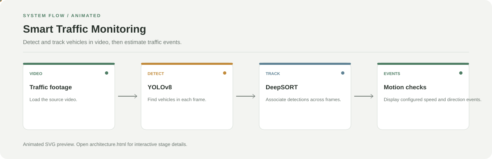

# Smart Traffic Monitoring

**Detect and track vehicles in video, then estimate traffic events.**

[](https://github.com/chyk2468/Deep-Learning-Project)

## 1. Project Title & Tagline

Detect and track vehicles in video, then estimate traffic events.

## 2. Problem Statement

Traffic footage contains many moving objects, making manual counting and review time-consuming. This project applies object detection and tracking to surface vehicle movement and configured traffic events.

## 3. Project Preview

Add a real screenshot or short GIF showing the main interaction and output.

[Open interactive architecture](architecture.html)

## 4. Overview

The application follows a clear sequence from input to processing and output. The workflow below highlights the main stages to help readers understand the project quickly.

## 5. Key Features

- Detect vehicles in video frames with YOLOv8.
- Track vehicles across frames with DeepSORT.
- Estimate movement and check configured speed or direction conditions.
- Display processed video and detected events.

## 6. Architecture / Workflow



Open the [interactive architecture explorer](architecture.html) to select a stage and inspect its role.

## 7. Tech Stack

Python, Streamlit, OpenCV, Ultralytics YOLOv8, DeepSORT, NumPy, Pandas

## 8. Installation & Setup

```bash
git clone https://github.com/chyk2468/Deep-Learning-Project.git
cd Deep-Learning-Project
python -m venv .venv
pip install streamlit opencv-python numpy pandas ultralytics deep-sort-realtime
```

## 9. Usage

Run `streamlit run app.py`, upload a video, and review the annotated output and event summary. Validate frame rate and camera geometry before interpreting speed estimates.

## 10. Project Structure

- `app.py`: Streamlit entry point
- `yolov8n.pt`: detector weights, if present
- tracking and processing logic: follow imports from `app.py`
- `requirements.txt`: dependencies, if present

## 11. Results & Demo

Add a short annotated-video demo and report detection/tracking metrics on a labelled test clip. Speed estimates require scene-specific calibration.

## 12. Future Enhancements

- Add calibration guidance and validation.
- Track per-class detection and tracking metrics.
- Export event summaries to CSV.
- Test occlusion and low-light conditions.

## 13. License

Check the source-code and model-weight licences before redistribution.
