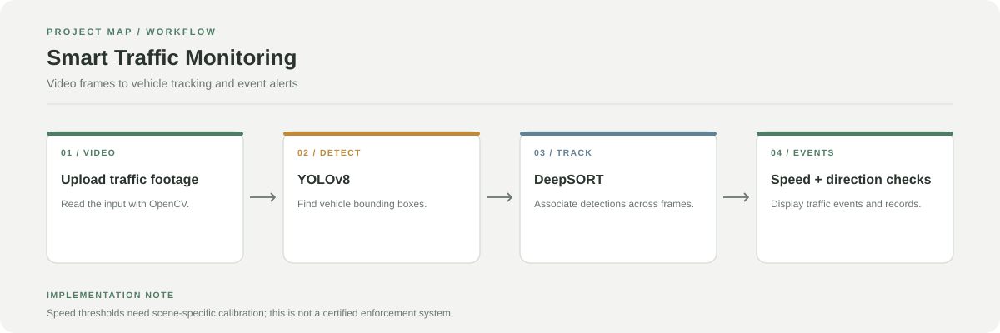

# Smart Traffic Monitoring System

A Streamlit computer-vision project that detects and tracks vehicles in traffic video, estimates motion, and checks configured speed and direction conditions.

**Stack:** Python, Streamlit, OpenCV, YOLOv8/Ultralytics, DeepSORT, NumPy, Pandas



## Pipeline

1. Upload a traffic video.
2. Run YOLOv8 to detect vehicles in each frame.
3. Use DeepSORT to maintain track identities across frames.
4. Estimate movement and check configured speed and wrong-way conditions.
5. Show the processed video and detected events.

## Run locally

```bash
git clone https://github.com/chyk2468/Deep-Learning-Project.git
cd Deep-Learning-Project
python -m venv .venv
```

Activate the environment, install the packages used by the app, and launch:

```bash
pip install streamlit opencv-python numpy pandas ultralytics deep-sort-realtime
streamlit run app.py
```

The repository includes `yolov8n.pt`; check the model-loading path in `app.py` before changing model files.

## Notes

Real-world speed estimation depends on video frame rate, image geometry, calibration, and tracking quality. Validate the results before using them for operational decisions.
